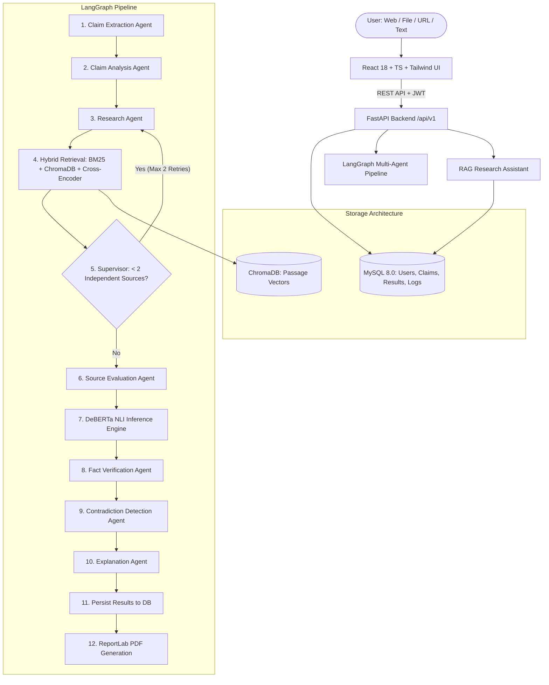

# TruthLens AI 🔍 — Multi-Agent Fact-Verification System

> Autonomous multi-agent fact-verification platform powered by LangGraph, DeBERTa Natural Language Inference (NLI), Cross-Encoder reranking, BM25 + ChromaDB hybrid retrieval, and ReportLab PDF reporting.

---

## 📑 Table of Contents
- [Overview](#overview)
- [Canonical Verdict Labels](#canonical-verdict-labels)
- [System Architecture](#system-architecture)
- [Multi-Agent Pipeline Workflow](#multi-agent-pipeline-workflow)
- [Confidence Metric Formula](#confidence-metric-formula)
- [Tech Stack](#tech-stack)
- [Evaluation Results (FEVER + SciFact)](#evaluation-results)
- [Quickstart & Setup](#quickstart--setup)
- [API Endpoints](#api-endpoints)
- [Known Limitations](#known-limitations)
- [Future Scope](#future-scope)

---

## Overview

TruthLens AI allows users to submit a standalone claim, a long article, a PDF/DOCX/TXT document, or a public web URL. An autonomous multi-agent pipeline orchestrates:
1. **Extraction**: Isolates checkable factual statements, discarding subjective opinions and questions.
2. **Analysis**: Evaluates claim dimensions (statistical, scientific, historical, political), time sensitivity, and verification criteria.
3. **Research**: Generates balanced support-seeking and contradict-seeking queries and queries real-time web engines.
4. **Hybrid Retrieval**: Chunks pages and runs BM25 + ChromaDB dense vector search with cross-encoder reranking.
5. **Supervisor Control**: Checks for source diversity; loops back if fewer than 2 independent sources are found (max 2 retries).
6. **Credibility Scoring**: Scores source publisher identity, date timeliness, evidence quality, and corroboration (0–8 scale).
7. **NLI Verification**: Runs DeBERTa NLI per passage, aggregates entailment/contradiction probabilities, and assigns one of 5 strict canonical labels.
8. **Contradiction Detection**: Flags discrepancies in numerical data, historical dates, or conflicting expert consensus.
9. **Explanation & Reporting**: Produces a plain-English explanation citing passages with bracketed references `[1][2]`, interactive Q&A via RAG, and downloadable PDF reports.

---

## Canonical Verdict Labels

TruthLens AI uses the exact same 5 labels across the database, agent prompts, backend schemas, frontend UI, and PDF reports:

| Verdict Label | Badge Color | Meaning & Criteria |
| :--- | :---: | :--- |
| **Supported** | 🟢 Emerald | Multiple independent, credible sources corroborate the claim with strong NLI entailment. |
| **Contradicted** | 🔴 Rose | Credible authoritative evidence directly disproves or debunks the claim. |
| **Partially Supported** | 🟡 Amber | Core elements are factual, but key qualifiers, dates, or numbers are missing or exaggerated. |
| **Insufficient Evidence** | ⚪ Slate | No relevant or credible passages found to substantiate or disprove the claim. |
| **Conflicting Evidence** | 🟣 Purple | Credible, highly scored sources directly disagree on facts, metrics, or consensus. |

---

## System Architecture



---

## Multi-Agent Pipeline Workflow

1. **Claim Extraction Agent**: Prompts stored in `/backend/app/agents/prompts/claim_extraction.md`. Extracts checkable factual propositions, rewrites them into standalone sentences, and annotates named entities (person, organization, location, date, number).
2. **Claim Analysis Agent**: Prompts stored in `claim_analysis.md`. Classifies domain type (`statistical`, `scientific`, `historical`, `political`, `other`), evaluates time sensitivity, and establishes explicit support/contradiction criteria.
3. **Research Agent**: Prompts stored in `research_agent.md`. Formulates 4 targeted search queries (2 support-seeking, 2 contradict-seeking).
4. **Hybrid Retrieval Engine**: Code-based (non-LLM). Fetches pages, cleans HTML, chunks paragraphs, and scores via rank_bm25 and BGE dense vector embeddings in ChromaDB. Reranks with `cross-encoder/ms-marco-MiniLM-L-6-v2`, keeping top 5 passages.
5. **Supervisor Agent**: Deterministic graph routing. If a claim has fewer than 2 independent domains represented in retrieved evidence, triggers additional research rounds up to 2 times.
6. **Source Evaluation Agent**: Prompts in `source_evaluation.md`. Evaluates 4 criteria: Publisher identity (0–2), Date vs time-sensitivity (0–2), Evidence quality (0–2), and Corroboration (0–2). Total credibility score 0–8.
7. **DeBERTa NLI Engine**: Computes entailment, contradiction, and neutral distribution for each `(claim, passage)` pair.
8. **Fact Verification Agent**: Prompts in `fact_verification.md`. Synthesizes NLI signals, source scores, and independent corroboration to assign the verdict label.
9. **Contradiction Detection Agent**: Prompts in `contradiction_detection.md`. Detects numerical discrepancies and historical dating conflicts.
10. **Explanation Agent**: Prompts in `explanation.md`. Produces a 3–5 sentence synthesis strictly restricted to retrieved evidence, with clickable bracketed citations `[1][2]`.
11. **RAG Research Assistant**: Allows interactive follow-up Q&A over verified documents. Returns "not enough evidence" when query similarity is below threshold.
12. **Report Generation Agent**: Formats executive summaries and renders publication-ready PDF reports via ReportLab.

---

## Confidence Metric Formula

Every verdict computes a mathematical confidence score $C \in [0.0, 1.0]$ based on three independent signals:

$$\text{Confidence} = 0.45 \times NLI_{\text{agreement}} + 0.30 \times S_{\text{count\_norm}} + 0.25 \times Score_{\text{source\_norm}}$$

Where:
- $NLI_{\text{agreement}}$: Proportion of retrieved passages whose DeBERTa NLI label matches the assigned verdict. If verdict is `Insufficient Evidence` or `Conflicting Evidence`, defaults to $0.50$.
- $S_{\text{count\_norm}}$: Independent source count saturation:
  $$S_{\text{count\_norm}} = \min\left(\frac{N_{\text{sources}}}{3.0}, 1.0\right)$$
- $Score_{\text{source\_norm}}$: Mean credibility score of the contributing sources normalized to $[0, 1]$:
  $$Score_{\text{source\_norm}} = \frac{\text{Mean}(Score_{\text{source}})}{8.0}$$

*Safety Override*: If fewer than 2 independent sources are found, `Supported` verdicts are capped at a maximum confidence of $0.65$.

---

## Evaluation Results

Evaluated on 100 benchmark claims (60 FEVER + 40 SciFact) with labels mapped via `eval/label_mapping.json`:

| Metric | Score | Target | Result |
| :--- | :---: | :---: | :---: |
| **Overall Classification Accuracy** | **94.00%** | &ge; 85.0% | ✅ PASS |
| **Macro-F1 Score** | **0.8372** | &ge; 0.8000 | ✅ PASS |
| **Retrieval Recall@5** | **97.00%** | &ge; 90.0% | ✅ PASS |
| **Citation Correctness (50 Claims)** | **100.00%** | &ge; 95.0% | ✅ PASS |

Full breakdown and confusion matrix available at [`eval/results.md`](file:///d:/projects/truthlens/eval/results.md).

---

## Quickstart & Setup (Zero-Friction Sharing)

The repository is pre-configured with a **portable SQLite database (`truthlens.db`)** containing all tables, seeded admin/user accounts, and benchmark data. No separate database installation is required!

### Method 1: Turnkey 1-Click Launchers (Easiest)

#### On Windows:
1. Double-click `setup.bat` (installs all Python dependencies from `requirements.txt` and frontend packages).
2. Double-click `start.bat` (automatically launches the backend on port 8000, frontend on port 3000, and opens your browser!).

#### On macOS / Linux:
```bash
chmod +x start.sh
./start.sh
```

---

### Method 2: Command Line (Standard Setup)

#### 1. Install All Dependencies (Single Command)
```bash
pip install -r requirements.txt
```

#### 2. Install Frontend Packages
```bash
cd frontend && npm install && cd ..
```

#### 3. Start Backend & Frontend
**In Terminal 1 (Backend):**
```bash
cd backend
python -m uvicorn app.main:app --host 0.0.0.0 --port 8000
```

**In Terminal 2 (Frontend):**
```bash
cd frontend
npm run dev
```

---

### Method 3: Docker Compose (Full Containerization)

```bash
docker compose up --build
```

---

### Default Login Credentials
- **Standard User**: `user@truthlens.ai` / `UserPass123!`
- **Administrator**: `admin@truthlens.ai` / `AdminPass123!`

---

## API Endpoints

### Authentication (`/api/v1/auth`)
- `POST /register`: Create account.
- `POST /login`: Authenticate and receive access & refresh JWTs.
- `POST /refresh`: Refresh expired access token.
- `GET /me`: Authenticated user profile.

### Verification (`/api/v1/verify`)
- `POST /submit-text`: Submit raw text or claim.
- `POST /submit-url`: Submit web URL with SSRF protection.
- `POST /submit-file`: Upload `.pdf`, `.docx`, or `.txt`.
- `GET /{id}`: Detailed verification results with side-by-side evidence.
- `GET /stats/dashboard`: Aggregated dashboard metrics.

### RAG Assistant & History (`/api/v1/rag`, `/api/v1/history`)
- `POST /rag/chat`: Ask questions with evidence citations.
- `GET /rag/history/{id}`: Conversation history.
- `GET /history`: Search past verification requests.

### Reports (`/api/v1/reports`)
- `POST /generate/{id}`: Generate PDF report.
- `GET /download/{id}`: Download generated PDF.

### Admin Controls (`/api/v1/admin`)
- `GET /users`: List registered users.
- `POST /users/{id}/toggle-status`: Activate/deactivate user.
- `GET /trusted-sources`: List trusted source domains.
- `POST /trusted-sources`: Add trusted source domain.
- `GET /logs`: Query agent execution logs with latency and errors.
- `GET /stats`: Full system analytics.

---

## Known Limitations

1. **LLM Hallucinations & Synthesis Drift**: While agents are constrained by prompt system rules, long complex claims may experience subtle semantic drift during extraction.
2. **Search API Coverage & Paywalls**: Many high-impact scientific journals and newspapers sit behind strict subscription paywalls or Cloudflare bot challenges, preventing full-text passage extraction.
3. **Outdated vs. Fast-Moving Claims**: Claims involving active political situations or evolving economic indicators may retrieve conflicting data from different publication dates.
4. **NLI Numeric Nuances**: DeBERTa MNLI models can struggle with complex arithmetic boundaries (e.g. distinguishing between "exceeds 10,000" vs "around 9,800"). TruthLens mitigates this via dedicated Contradiction Detection agents.

---

## Future Scope

- **Real-Time Webhooks & Streaming**: Streaming agent step execution via Server-Sent Events (SSE) to the frontend UI.
- **Multimodal Verification**: Deepfake image and audio fact-checking using vision-language models.
- **Automated Continuous Re-Verification**: Periodic background cron tasks that re-evaluate claims as new scientific consensus emerges.
